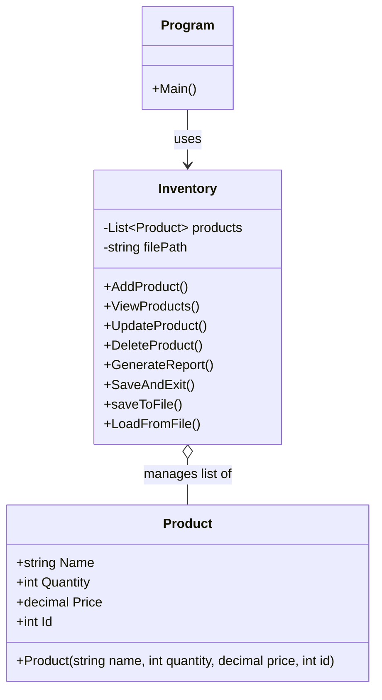

# 🛒 Minimarket Inventory System (`InventoryManager`)

A clean C# console application designed to help small shop owners manage their product catalog, stock levels, pricing, and financial inventory valuation with automatic local JSON data persistence.

---

## ✨ Features

* **Product Management (CRUD):** Add, view, update, and delete products through an intuitive, color-coded console menu.
* **Automatic Unique ID Generation:** Generates collision-free 4-digit random IDs (`1000–9999`) verified via LINQ.
* **Defensive Input Validation:** Prevents runtime crashes using `TryParse` validation loops and empty-string checks.
* **Formatted Tabular Display:** Aligns product IDs, names, stock quantities, and prices into readable console columns.
* **Inventory Financial Report:** Calculates total unique products, total stock units, and overall inventory monetary value.
* **Local JSON Persistence:** Automatically loads existing data on startup and saves changes to `inventory.json` on exit using `System.Text.Json`.

---

## 🏗️ Architecture & UML Class Diagram

The project follows an **Object-Oriented Programming (OOP)** design with a clear separation of concerns across three layers:
1. **Models (`InventoryManager.Models`):** Defines the `Product` data blueprint.
2. **Services (`InventoryManager.Services`):** Encapsulates business logic, LINQ queries, validation loops, and JSON file handling inside `Inventory`.
3. **Presentation (`Program.cs`):** Manages the interactive main menu loop.



---

## 📁 Project Structure

```text
InventoryManager/
├── Models/
│   └── Product.cs          # Data model representing an inventory item
├── Services/
│   └── Inventory.cs        # Core CRUD operations, reporting, and JSON file I/O
├── Program.cs              # Application entry point and main menu loop
├── inventory.json          # Auto-generated local storage file
└── README.md               # Project documentation
```

---

## 🚀 Getting Started

### Prerequisites
* [.NET SDK](https://dotnet.microsoft.com/download) (8.0 or later recommended)

### Installation & Running

1. **Clone the repository:**
   ```bash
   git clone [https://github.com/munozjh/InventoryManager.git](https://github.com/munozjh/InventoryManager.git)
   cd InventoryManager
   ```

2. **Build and run the application:**
   ```bash
   dotnet run
   ```

---

## 🛠️ Technologies & C# Concepts Used

* **C# / .NET**
* **LINQ (`System.Linq`):** `.Any()`, `.FirstOrDefault()`, and `.Sum()` for searching and report aggregations.
* **JSON Serialization (`System.Text.Json`):** `JsonSerializer.Serialize` and `JsonSerializer.Deserialize` with formatted indentation.
* **Error Handling:** Defensive parsing (`int.TryParse`, `decimal.TryParse`) and `try-catch` blocks for safe file I/O operations.

---
